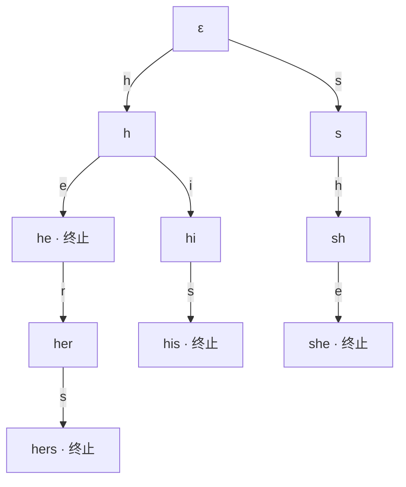
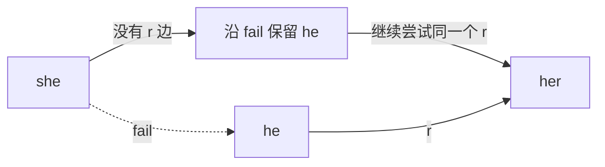
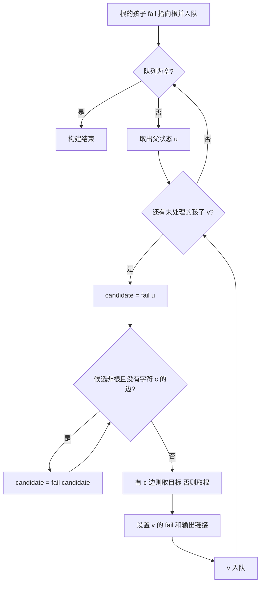
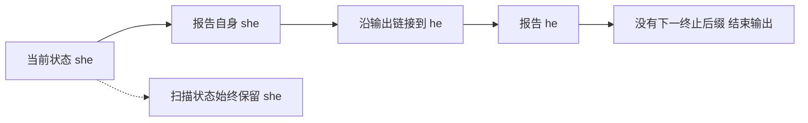
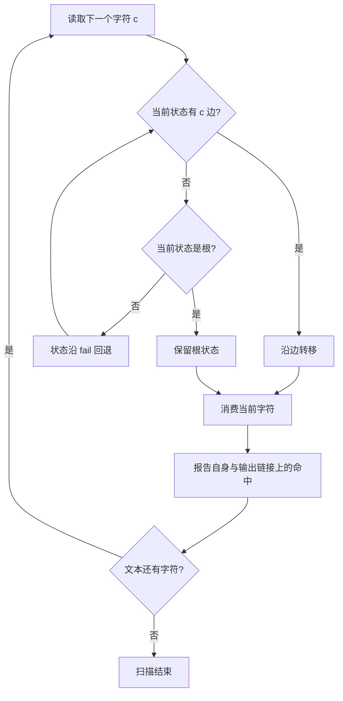
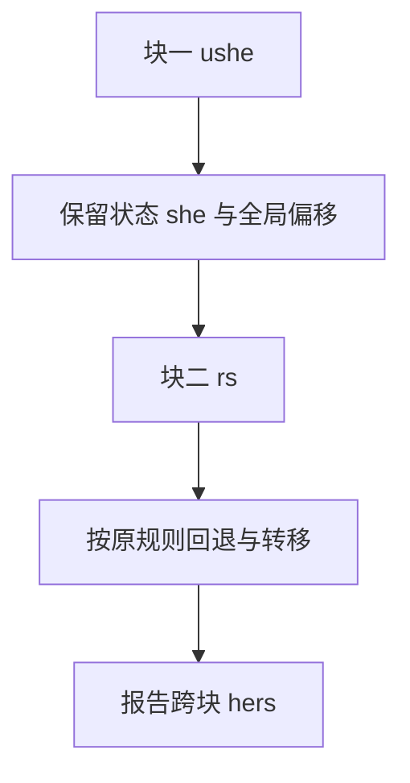
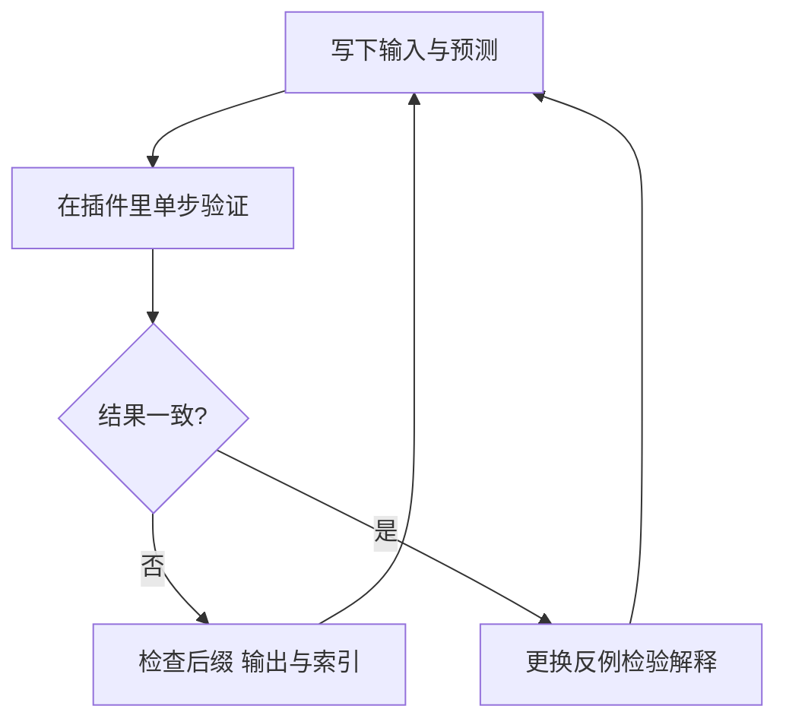

# AC 自动机：从多模式匹配到数学原理与工程实现

## 00 · 阅读指南与学习路线

AC 自动机（Aho–Corasick automaton）解决这样一个问题：给定许多关键词，找出它们在一段文本中的全部出现位置。它把关键词组织成一台状态机，让已经读过的文本提供的信息得到复用。

本教程希望你不仅能写出代码，还能解释：状态究竟记住了什么；失配时为什么可以这样跳；为什么不会漏掉较短的关键词；一次字符处理可能回退多次，整体扫描为什么仍然快。

### 如何使用这份教材

建议先读问题与 Trie，再读 fail、BFS 和输出链接。第一次阅读可以先看例子，第二次再补证明。完整实现位于第 11 章，练习与答案在第 14 章。


你只需要了解字符串、树、队列和基本循环。涉及数学符号时，正文会先解释概念，再给出形式化定义。公式使用可复制的 Unicode 文本，图示使用 Mermaid；在插件中，图由相同源码预生成，随教材离线提供。

### 全书共用的例子

```text
关键词 P = {he, she, his, hers}
文本   T = ushers

文本下标：0 1 2 3 4 5
字符：    u s h e r s

全部结果：she [1,4)，he [2,4)，hers [2,6)
```

区间从 0 开始，右端不包含。这样区间长度就是 end − start，相邻区间也容易拼接。在这个 ASCII 例子中，码点下标与 UTF-16 下标相同；第 12 章会解释它们在 emoji 中的区别。

### 理解以后应该能完成什么

1. 手工画出经典词典的 Trie 和全部 fail 链接。
2. 不运行程序，预测 `ushers` 的状态与输出。
3. 用一个不变量解释扫描的可靠性与完备性。
4. 说明 O(N + Z) 的前提，识别实现中的额外存储与绘图开销。
5. 修改词典并用朴素匹配器对照验证。

在 Document 顶部切换“完整教程”“跟着学”“自己试”。进入教程会暂停播放；切回课堂后实验仍停留在原位置。教材中的经典输入与自定义实验是两个概念，修改实验不会改写正文。

## 01 · 历史：从文献检索需求出发

Alfred V. Aho 与 Margaret J. Corasick 在 1975 年发表论文《Efficient String Matching: An Aid to Bibliographic Search》，刊于 Communications of the ACM，18 卷 6 期，333–340 页。论文的实际背景是文献检索中的关键词与短语搜索。[论文与出版信息](https://doi.org/10.1145/360825.360855)

这里值得理解的是问题本身。假设用户提交几十个关键词，要在大量记录中判断哪些词出现过、出现在哪里。如果每个关键词各自从头扫描，许多文本内容会被反复访问。关键词越多，这种重复就越明显。

可以把优化思路分成两层。第一层，把关键词本身的共性提取出来：`he`、`hers`、`his` 可以共享开头的 `h`。第二层，把已经读过的文本利用起来：读到 `she` 后，即使不能继续沿原路径走，末尾的 `he` 仍然可能继续延伸成 `hers`。

本教程后面的推导是教学重建，按“需求如何导出结构”的顺序组织，不把这种讲解顺序当成作者真实的发明过程。与 KMP 的比较也属于思想比较，不能仅由相似性推断具体的历史影响关系。

### 为什么今天仍值得学习

AC 把“共享结构”“利用失配信息”“用状态概括历史”“预处理与查询分离”放进同一个算法中。这些思想也会在解析器、协议处理和其他状态机中出现。

适合它的问题通常拥有一组可预处理的精确关键词，需要扫描一段或多段文本。是否采用它，需要结合词典规模、复用次数、匹配语义和内存预算判断。一个很短的关键词搜索，并不天然需要构建一台自动机。

### 本章自测

为什么词典固定、文本不断变化的场景可能适合预处理？因为词典构建成本可以被多次扫描分摊。若词典每次都完全变化，就必须把重建成本一并计入。

## 02 · 问题定义与朴素方法

设关键词集合为 P = {p₁, p₂, …, pₖ}，每个关键词非空。给定文本 T，要求枚举所有三元组 `(patternId, start, end)`，使 T[start..end) 与对应关键词精确相等。允许两个结果重叠，也允许不同关键词在同一位置结束。

在 `ushers` 中，`she` 和 `he` 的结束位置相同，`he` 和 `hers` 的起点相同。算法都应该报告。单纯回答“出现过几个不同关键词”和“报告全部出现位置”是不同任务。

### 逐词搜索重复了什么

最直观的做法是逐个关键词尝试所有起点，每次从词首比较。当许多词共享前缀时，这些字符比较也会重复。若关键词总长度为 M，文本长度为 N，直接枚举并逐字符比较的粗略最坏上界为 O(NM + Z)，Z 表示输出的结果数。

即使给每个词单独使用线性单模式算法，分别扫描 k 个关键词仍会带来约 O(kN + M + Z) 的工作。这里的问题是如何让多个关键词共同扫描文本。

### 只建 Trie 还不够

Trie 可以共享关键词前缀。但如果对文本的每一个起点都重新从 Trie 根节点向下走，同一段文本仍可能被反复读取。设最长关键词长度为 H，这种方法的粗略上界为 O(NH + Z)。

我们真正需要的，是在当前位置无法继续时，找到一个可继续的后缀状态，不必把文本退回旧位置重新开始。

### 明确任务边界

本教材主体研究精确、区分大小写、允许重叠、报告全部结果的匹配。默认不做分词，不把 `he` 限制为独立英文单词，也不自动选择最长结果。中文同样作为符号序列处理。

这些约定先于实现。若产品想要“仅取最长、不允许重叠”，需要额外定义选择策略，不能直接删掉较短输出就认为任务已经解决。

## 03 · 数学准备：字符串、后缀与状态

### 字符串与字母表

字母表 Σ 是本次模型允许的符号集合。字符串是符号的有限序列。ε 表示空串，|x| 表示字符串 x 的符号数量。连接字符串 x 和字符 c 写作 xc。

教材理论部分以“符号”为单位计数。当前插件把一个 Unicode 码点当成一个符号，所以 `🙂` 的符号长度是 1；C# 字符串的 `Length` 则以 UTF-16 单元计数，该字符占 2 个单元。

### 前缀、后缀与真后缀

若 x = uv，则 u 是 x 的前缀，v 是 x 的后缀。空串同时是任意字符串的前缀和后缀。真后缀要求 v ≠ x，也就是不能把整个字符串本身算进去。

`she` 的前缀是 ε、s、sh、she；后缀是 ε、e、he、she；真后缀是 ε、e、he。`sh` 是前缀，却不是后缀，这个区别决定了失配时不能简单退到父节点。

### 用状态表示词典前缀

令 Pref(P) 包含词典中所有非空前缀，则状态集合为：

```text
Q = {ε} ∪ Pref(P)
L(q) = 从根到状态 q 的路径字符串
depth(q) = |L(q)|
```

每个状态对应一个不同的路径字符串，所以同一个前缀不会拥有两个状态。完整关键词也是前缀，因此终止状态可以继续拥有孩子。

### 自动机到底“自动”在哪里

一旦词典预处理完成，当前状态与下一个字符就足以决定新的状态，并确定要报告的结果。无需保存全部已读文本来选择下一条转移。

我们把完整转移写成 δ(q,c)。它包含直接走 Trie 边、必要时沿 fail 回退、最终在根兜底的完整规则。因此，对任意 q 与 c，δ 都有确定的结果。稀疏 Trie 边本身却是部分函数，有的边不存在。

AC 可以理解为带输出的确定性状态机，但不应由此推断它已经是状态数最少的自动机，也不能把“非终止状态”等同于“无用状态”。例如 `her` 本身不是关键词，仍然关系到接下来能否读出 `hers`。

## 04 · Trie：让词典共享前缀

### 从一棵树开始

插入一个关键词时，从根开始逐字符前进：已有边就复用，没有边就新建。词尾节点记录关键词身份。这里不额外插入“结束字符”；终止信息是节点的属性。

经典词典的 Trie 如下。节点显示路径字符串，边只标记本次读入的字符，带“终止”的节点代表完整关键词。



### 插入顺序决定编号，不决定数学含义

先插入 `he`，创建 h、he。再插入 `she`，创建 s、sh、she。插入 `his` 时复用 h，创建 hi、his。最后插入 `hers`，复用 h、he，只创建 her、hers。

经典词典总长度为 2 + 3 + 3 + 4 = 12，实际只有 9 个非根状态，加根共 10 个。每插入一个字符最多新增一个状态，因此：

```text
S = |Q| ≤ M + 1
```

这个界描述状态数量，不代表所有实现都只占 O(M) 字节。如果每个节点额外保存完整路径字符串，长链上的路径副本会累积；如果每一步都存一份可视化快照，还会有轨迹成本。

### 在插件里验证

进入“自己试”，载入经典案例，点击“从根重新构建”。逐次点击“下一步”，区分“新建节点”“复用前缀”“标记词尾”三个事件。特别观察 `he`：它既是终止节点，又有指向 `her` 的边。

自测：插入 `he` 后插入 `hers`，为什么只新增两个状态？因为 h 和 he 已存在，只需要 her、hers。共享的是路径，不是把两个完整词合成同一个关键词。

## 05 · fail：失配以后保留什么

### 从一次真实失配出发

扫描 `ushers`，读完前四个字符后，文本末尾是 `she`，当前状态为 she。下一个字符是 r，但 she 没有 r 边。此时直接回根会丢掉什么？会丢掉已读文本末尾的 `he`，而它恰好可以接 r，继续形成 `her`。

正确的问题是：当前已读内容有哪些后缀，仍然是词典中的前缀？这些候选可以代表尚未失去的匹配机会。



### 正式定义

对非根状态 q，fail(q) 对应满足以下条件的最长字符串 s：

```text
s 是 L(q) 的真后缀
s ∈ Q 所代表的路径字符串集合
```

根是特例：fail(root) = root。由于 ε 一定是候选，非根状态的 fail 总能定义。由于每个长度的后缀只有一个，最长候选也是唯一的。

对 she，候选后缀依次是 he、e、ε，其中 he 是词典前缀，因此 fail(she)=he。对 her，真后缀 er、r 都不是词典前缀，所以 fail(her)=ε。

### 为什么不能退到父节点

she 的父节点是 sh，但已读文本的末尾并不是 sh。若直接把状态设为 sh，就等于宣称“刚刚读到的文本以 sh 结尾”，这与事实不符。父子关系描述前缀增长，fail 关系描述文本末尾仍可复用的信息。

### fail 链为什么会结束

非根状态的 fail 指向严格更短的路径：depth(fail(q)) < depth(q)。深度为非负整数，连续回退必然到根。根的自环需要单独终止条件，因此扫描循环使用 `state != root`。

### 为什么一条链能覆盖全部候选

设 a 是 L(q) 的最长有效真后缀，b 是更短的有效后缀。由于 a 与 b 都是同一个字符串的后缀，且 b 更短，b 必然也是 a 的后缀。于是从 a 再取最长有效真后缀，可以逐层枚举剩余候选。

这解释了为什么无需在节点上保存“所有可能回退的位置”：通过 fail 链按长度递减访问即可。

在“跟着学”的 fail 章节演示 she→he，并检查右侧后缀解释。自测：fail(he) 为什么不是 h？因为 h 不是 he 的后缀。

## 06 · BFS：按依赖顺序构造 fail

### 从父状态推导子状态

考虑 Trie 边 u ─c→ v，路径字符串满足 L(v)=L(u)c。寻找 v 的真后缀时，可以先取 u 的有效后缀，再尝试追加 c。因此对非根父状态：

```text
fail(v) = δ(fail(u), c)       （u ≠ root）
```

这里的 δ 是包含回退的完整转移，不是一次简单的边查询。根的直接孩子必须单独设为 root；如果把一般公式直接套到根孩子，可能沿根的同名边得到孩子自己，破坏“真后缀”的要求。



### 为什么使用 BFS

计算 v 的 fail 时，依赖 u 的 fail，以及更浅状态的后缀信息。BFS 按深度从小到大处理，保证这些信息已经就绪。它不是因为“树只能用 BFS”，而是因为这里的计算依赖与层序自然一致。

### 经典词典的完整 fail 表

| 状态 | fail | 原因 |
| --- | --- | --- |
| ε | ε | 根的约定 |
| h | ε | 没有非空真后缀 |
| s | ε | 没有非空真后缀 |
| he | ε | e 不是词典前缀 |
| hi | ε | i 不是词典前缀 |
| sh | h | h 是最长有效真后缀 |
| her | ε | er、r 都不是词典前缀 |
| his | s | s 是最长有效真后缀 |
| she | he | he 是最长有效真后缀 |
| hers | s | ers、rs 无效，s 有效 |

在当前词典插入顺序下，队列可经历：`[h,s]` → `[s,he,hi]` → `[he,hi,sh]` → `[hi,sh,her]`。具体的同层顺序可以随边枚举顺序变化；只要依赖成立，最终后缀关系应相同。

自测：为什么给 she 构建 fail 时，会先从 fail(sh)=h 开始？因为已知 sh 的有效后缀 h，再追加字符 e，就得到 she 的有效后缀 he。

## 07 · 输出链接：一次状态转移可能命中多个词

### 终止标记与全部输出

到达 she 时，she 是一个完整关键词。同时，fail(she)=he，而 he 也是完整关键词。因此在同一个结束位置，应报告两个结果。

令 Own(q) 表示恰好在 q 结束的关键词，Out(q) 表示到达 q 时应报告的全部关键词。对非根状态：

```text
Out(root) = ∅
Out(q) = Own(q) ∪ Out(fail(q))
Out(she) = {she, he}
```

根的输出单独定义为空，因为本教材不接受空关键词。不能对根无限套用递归式。

### 两种实现与各自代价

一种实现把继承输出直接复制到每个节点。它容易理解，但很多词存在后缀关系时，输出列表可能大量重复。

另一种实现保存 outputLink(q)：沿 fail 链遇到的第一个终止状态；没有则记为 −1。扫描时先检查自身，再沿 outputLink 访问其余终止后缀。每跳到一个有效输出链接，就对应实际需要报告的关键词。



构建时，若 fail(v) 是终止状态，则 outputLink(v)=fail(v)；否则继承 outputLink(fail(v))。BFS 同样保证依赖已经建立。

### 为什么不应把扫描状态改成输出状态

报告 he 是为了补充结果，不表示应把扫描状态永久改为 he。she 是更长的有效后缀，仍可能存在自己的后续边。输出遍历使用局部变量，扫描状态保持不变。

### 重叠例子

对 P={a,aa,aaa}、T=aaa：第一个 a 输出 a；第二个 a 输出 aa、a；第三个 a 输出 aaa、aa、a，共 6 条。关键词只有 3 个，出现次数却是 6 次。

插件的“重叠”预设使用文本 aaaaa，因此会有 5 + 4 + 3 = 12 条结果。注意区分教材手算的 aaa 与预设里的 aaaaa。

## 08 · 扫描：状态回退，文本向前

### 一次字符处理的完整顺序

读取字符不等于立即消费字符。当前状态没有相应边时，需要沿 fail 更换候选，继续尝试同一个字符。直到找到边，或确认根也没有边，才完成本字符的处理。



### ushers 的逐字符表

| 本次字符 | 原状态 | 转移与必要回退 | 消费后的状态 | 新结果 |
| --- | --- | --- | --- | --- |
| u | ε | 根无 u 边 | ε | 无 |
| s | ε | 沿 s 边 | s | 无 |
| h | s | 沿 h 边 | sh | 无 |
| e | sh | 沿 e 边 | she | she [1,4)，he [2,4) |
| r | she | she 无 r 边，退到 he，再走 r | her | 无 |
| s | her | 沿 s 边 | hers | hers [2,6) |

关键在 r 这一行。回退并没有重新读取 s、h、e，也没有把 r 丢掉。状态 he 已经代表“已读文本以 he 结尾”这件事实，所以可以直接尝试 r。

### 伪代码

```text
state = root
for each c in text:
    while state != root and edge(state, c) does not exist:
        state = fail(state)
    if edge(state, c) exists:
        state = edge(state, c)
    else:
        state = root
    consume c
    emit Own(state)
    emit terminal suffixes through outputLink
```

### 在插件里验证

载入经典例子，切到扫描阶段。逐步观察“读取→比较→回退→再次比较→消费→输出”。处理 r 时，回退步骤中的已消费码点数量应保持为 4；随后转移到 her 才变成 5。

同一结束位置的 she 和 he 分两步报告，因此两次输出之间文本游标也不变。算法事件数与文本字符数不同，时间轴有许多步不意味着文本被多次扫描。

## 09 · 正确性：状态究竟概括了什么

### 核心不变量

读完文本前 i 个符号后，当前状态 q 满足：

```text
L(q) 是 T[0..i) 的所有后缀中，同时属于 Q 的最长字符串。
```

它把已经读过的全部文本，压缩为与后续匹配有关的一份信息。较短候选仍能由 fail 链恢复。

不变量描述的是“本字符处理完成后”的扫描状态。在一次回退事件中，当前状态只是正在尝试的较短候选，不能要求它在尚未消费字符时始终保持最长。

### 用归纳法证明状态不变量

初始 i=0，已读文本为空，唯一候选为 ε，所以根满足不变量。

假设消费新字符 c 前不变量成立。新文本的任一非空有效后缀都可写成 xc，其中 x 是旧文本的后缀，而且 x 必须是词典前缀，因为 xc 是词典前缀。

旧状态 q 是最长的有效后缀。若它有 c 边，L(q)c 就是最长的新候选。若没有，则候选只能来自更短的有效后缀。fail 链按长度递减枚举它们，首次能够追加 c 的候选就是最长者。如果连根也没有 c 边，则新文本没有非空有效后缀，回根正确。

因此，每次消费字符后不变量继续成立。

### 可靠性：报告的结果都是真的

报告状态对应的完整词，或报告其终止后缀。由不变量，当前状态路径是已读文本的后缀；后缀的后缀仍然是后缀。因此每个报告词都确实在当前位置结束。

### 完备性：真实结果不会被漏掉

若关键词 w 在当前位置结束，那么 w 是已读文本的后缀，同时 w 自身属于词典前缀集合。由不变量，w 的长度不会超过当前状态路径。两者同为已读文本后缀，所以 w 要么就是当前路径，要么是当前路径的有效真后缀。

当前路径的终止标记与 fail 链覆盖这两种情况。输出链接仅跳过非终止状态，不跳过终止后缀，因此全部真实结果都会被报告。

### 不重复性与任务约定

词典按字符串去重后，每个终止状态对应一个关键词。输出链接严格向更短路径前进，不会重复访问同一终止状态。不同扫描位置的同一个词是不同出现，应分别保留。

如果产品把两个相同字符串视为两个业务规则，则一个终止状态应保存多个规则 ID。这是结果身份的扩展，不能简单套用“重复词合并”的输入策略。

## 10 · 复杂度：把前提与输出写完整

### 先定义参数

| 符号 | 含义 |
| --- | --- |
| k | 去重后的关键词数量 |
| M | 所有关键词的符号长度之和 |
| N | 文本的符号长度 |
| S | 状态数，S ≤ M + 1 |
| H | 最长关键词的符号长度 |
| σ | 完整转移表采用的字母表大小 |
| Z | 实际报告的匹配次数 |

### 为什么一次回退很多步，扫描仍然线性

取势能 Φ=depth(state)。一次成功 Trie 转移至多增加 1；一次 fail 回退至少减少 1。深度从 0 开始且始终非负，N 个字符最多使深度增加 N 次，因此扫描中的 fail 回退总次数最多也是 N 的量级。

在每次边查询为常数时间时，扫描转移工作为 O(N)。通过输出链接枚举结果，每个有效跳转产生一次输出，额外工作为 O(Z)，得到 O(N + Z)。哈希映射通常给出期望常数查询；有序映射则需要计入其查询成本。

这个分析适用于扫描过程。不能直接把同一个势能论证套到任意构建代码上，因为构建阶段会对不同孩子重新开始寻找后缀候选。

### 构建成本取决于表示

| 表示方式 | 构建与存储要点 |
| --- | --- |
| 稀疏 Trie 边 + 显式回退 | 只保存真实边；简单逐边沿 fail 查找的保守构建上界为 O(M + SH) 次期望常数操作 |
| 完整转移表 | 每个状态为 σ 个符号保存转移；通过 BFS 补表可得 O(M + Sσ) 构建时间与 O(Sσ) 转移存储 |
| 输出集合复制 | 另计所有被复制的输出项目数，不能只看状态与边 |
| 输出链接 | 每状态一个链接；实际报告按 Z 计费 |

这里给出的稀疏构建上界是保守界，不声称对所有实现都是最紧的界。教材第 11 章采用清晰的显式回退；若加入缓存、持久化映射等技术，应重新说明其前提与成本。

### 输出规模不能省略

若词典为 a、aa、…、a 的 H 次重复，文本为 N 个 a，且 N ≥ H，则结果数为：

```text
Z = N + (N−1) + … + (N−H+1)
  = HN − H(H−1)/2
```

结果本身可以很多。若要求枚举每个结果，就至少要为它们付出相应工作。把扫描写成 O(N) 而完全忽略 Z，会掩盖任务成本。

### 当前插件的额外开销

插件为了教学，保存每次比较、回退、转移和输出事件，还记录队列、fail 版本与可见进度。状态中也保存完整前缀用于解释。这些开销属于教学轨迹与展示，不属于只输出匹配结果的最小算法模型。

衡量纯匹配性能时，应分别统计输入处理、构建、扫描、输出收集和绘图；把界面总耗时直接称为 AC 的算法耗时，无法解释瓶颈。

## 11 · C#：一份可运行的参考实现

### 从对象到字段

下面代码使用 Unicode 码点作为边键，保留原文 UTF-16 位置。构造函数完成 Trie、fail 与输出链接；每次 Find 使用独立扫描状态。对象构造后不再修改词典。

这是一份便于读懂的独立参考实现，不生成插件教学轨迹。输入词典按 ordinal 去重，但不去除两端空白；插件界面的逐行解析规则见下一章。示例会先验证整个字符串的 Unicode 合法性，再生成匹配结果。

```csharp
using System;
using System.Buffers;
using System.Collections.Generic;
using System.Linq;
using System.Text;

public sealed class TutorialAc
{
    private sealed class Node
    {
        public Dictionary<int, int> Edges { get; } = new();
        public int Fail;
        public int Output = -1;
        public int Pattern = -1;
    }

    public readonly record struct Hit(int PatternId, int Start, int End);
    private readonly List<Node> nodes = new() { new Node() };
    private readonly string[] words;

    public TutorialAc(IEnumerable<string> patterns)
    {
        ArgumentNullException.ThrowIfNull(patterns);
        words = patterns.Distinct(StringComparer.Ordinal).ToArray();
        if (words.Length == 0) throw new ArgumentException("词典不能为空");
        for (var id = 0; id < words.Length; id++)
        {
            ArgumentException.ThrowIfNullOrEmpty(words[id]);
            var state = 0;
            foreach (var symbol in ReadSymbols(words[id]))
            {
                if (!nodes[state].Edges.TryGetValue(symbol.Key, out var next))
                {
                    next = nodes.Count;
                    nodes[state].Edges.Add(symbol.Key, next);
                    nodes.Add(new Node());
                }
                state = next;
            }
            nodes[state].Pattern = id;
        }

        var queue = new Queue<int>();
        foreach (var child in nodes[0].Edges.Values)
        {
            nodes[child].Fail = 0;
            queue.Enqueue(child);
        }
        while (queue.TryDequeue(out var parent))
        {
            foreach (var (key, child) in nodes[parent].Edges)
            {
                var candidate = nodes[parent].Fail;
                while (candidate != 0 && !nodes[candidate].Edges.ContainsKey(key))
                    candidate = nodes[candidate].Fail;
                var target = nodes[candidate].Edges.TryGetValue(key, out var found) ? found : 0;
                nodes[child].Fail = target;
                nodes[child].Output = nodes[target].Pattern >= 0 ? target : nodes[target].Output;
                queue.Enqueue(child);
            }
        }
    }

    public List<Hit> Find(string text)
    {
        ArgumentNullException.ThrowIfNull(text);
        var symbols = ReadSymbols(text);
        var results = new List<Hit>();
        var state = 0;
        foreach (var symbol in symbols)
        {
            while (state != 0 && !nodes[state].Edges.ContainsKey(symbol.Key))
                state = nodes[state].Fail;
            state = nodes[state].Edges.TryGetValue(symbol.Key, out var next) ? next : 0;
            var end = symbol.Offset + symbol.Length;
            for (var output = state; output >= 0; output = nodes[output].Output)
            {
                var id = nodes[output].Pattern;
                if (id >= 0) results.Add(new Hit(id, end - words[id].Length, end));
            }
        }
        return results;
    }

    private static List<(int Key, int Offset, int Length)> ReadSymbols(string text)
    {
        var symbols = new List<(int Key, int Offset, int Length)>();
        for (var offset = 0; offset < text.Length;)
        {
            var status = Rune.DecodeFromUtf16(text.AsSpan(offset), out var rune, out var length);
            if (status != OperationStatus.Done) throw new ArgumentException("包含非法 Unicode 代理序列");
            symbols.Add((rune.Value, offset, length));
            offset += length;
        }
        return symbols;
    }
}
```

### 如何调用

把上面的类放进启用隐式 using 的 .NET 控制台项目，添加以下调用即可。结果中 PatternId 对应去重后关键词的首次出现顺序。

```csharp
var patterns = new[] { "he", "she", "his", "hers" };
var ac = new TutorialAc(patterns);
foreach (var hit in ac.Find("ushers"))
    Console.WriteLine($"{patterns[hit.PatternId]} [{hit.Start},{hit.End})");

// she [1,4)
// he [2,4)
// hers [2,6)
```

### 逐段理解代码

nodes[0] 是根，Edges 是稀疏 Trie 边，Fail 是最长有效真后缀，Output 是下一终止后缀，Pattern 为 −1 表示本状态不是词尾。去重后一个词尾保存一个词 ID 即可。

构建根孩子时不沿一般公式查找，避免得到自身。对其余孩子，从父状态的 fail 开始尝试同一个边字符。Output 依赖目标状态的终止信息与输出链接，所以与 fail 一起在 BFS 中建立。

扫描中的 output 是另一个局部变量，绝不会覆盖 state。每次调用 Find 都从根开始，结果列表也是新建的。因此词典对象可以复用，单次扫描的状态不会串到下一次扫描。

### 存储与限制

此示例为清晰起见，预先把文本解码为符号列表，并把所有结果收集到列表，因此额外占用 O(N + Z) 空间。最小流式扫描器可以边解码边报告，减少这些缓冲；工程上仍需考虑输出接收方与输入错误的处理策略。

它没有教学画布的预算，也没有实现流式分块、匹配策略筛选与规范化。应用到大输入前，应根据实际任务补充预算、取消和输出接收机制。

## 12 · 工程语义：Unicode、索引与输入边界

### 码点、UTF-16 与可见字符

这三个单位并不相同。一个 emoji 可以占两个 UTF-16 单元；一个用户看到的字形还可能由多个码点组成，例如字母加组合附加符号。

```text
文本：🙂a🙂
UTF-16 区间：🙂 [0,2)，a [2,3)，🙂 [3,5)
码点序号：   0         1         2
```

当前插件按 Unicode 码点扫描，结果用原文 UTF-16 半开区间。若待匹配词是 `🙂a`，第一处结果为 [0,3)。若词为 `a`，结果为 [2,3)。不能把状态深度直接减去 UTF-16 结束位置来计算起点；它们的单位不同。

### 精确匹配意味着什么

插件不执行 Unicode 规范化与大小写折叠。视觉相似的字符串不保证码点序列相同。若先规范化或转换大小写，结果位置属于转换后的文本；要定位原文，还需要维护位置映射。

同样，“包含一个关键词”不等于“匹配一个独立词语”。若需要英文词边界、中文分词或规则优先级，必须在 AC 核心之外明确这些语义。

### 当前插件的逐行输入规则

- 每行一个关键词，去除两端空白，忽略空行。
- 以 ordinal 语义合并重复关键词，保留首次出现的顺序。
- 空文本合法，空词典与非法代理序列会报错。
- 匹配区分大小写，允许重叠，报告全部出现位置。
- 为教学预算，限制 40 个去重关键词、160 个状态、600 个文本码点和 12,000 个步骤；原始输入另有 UTF-16 长度限制。

这些是本插件的产品约定，不是 AC 的数学必要条件。尤其是两端空白处理，会使界面不适合直接输入以空格开头或结尾的精确模式。

### 草稿、成功轨迹与失败

编辑输入只修改草稿。成功应用以后，图和时间轴才切换到新实验。若输入错误或超过预算，保留上次成功轨迹，并显示错误信息。这样不会出现“图来自旧词典、结果来自新文本”的混合状态。

自测：在原文先做大小写折叠，再用新字符串位置切原文，有什么问题？变换可能改变长度或字符对应关系，必须明确索引空间，必要时保存映射。

## 13 · 扩展：从课堂走向实际任务

### 流式分块

若文本被拆成多个块，不能在每块开始都回根，否则会漏掉跨块关键词。例如关键词 hers，前块以 he 结束，后块以 rs 开始。保留当前扫描状态即可继续利用已读后缀。



实际分块时还要保留解码器的未完成输入：字节块可能在 UTF-8 编码中间断开，UTF-16 块也可能拆开代理对。状态连续性、解码连续性与全局偏移是三个相关但不同的问题。

当前插件整段处理输入，尚未提供流式接口；这里讲的是扩展方案。

### 只计数时可以减少输出枚举

若只要求总匹配次数，可以预计算 count(q)=OwnCount(q)+count(fail(q))，每读完一个字符累加 count(state)。这样无需枚举每个匹配位置。但如果要每个关键词分别计数或输出区间，算法与存储需求又会变化。

### 最长匹配与不重叠策略

对 P={a,aa}、T=aa，全部结果为 a[0,1)、aa[0,2)、a[1,2)。如果产品要求从左到右取最长不重叠结果，可能最终只保留 aa[0,2)。这需要等待候选并比较选择，不能在第一次看到 a 时就立即作出不可撤销决定。

应先说明“最早结束”“最左起点”“同起点最长”“不重叠”等具体规则，再设计后处理或专用扫描策略。不同规则可以给出不同结果。

### 动态词典

插入新关键词不仅可能增加 Trie 节点，也可能改变旧状态的最长有效后缀及输出链接。因此不能把“往树上插入几条边”直接当作完成动态更新。

对于当前教学规模，完整重建通常更容易验证。更大规模的动态字典需要专门的数据结构、更新算法与测试，不属于本教材首版实现。

### 稀疏与完整转移表的选择

小字母表可以考虑完整表，以内存换更直接的转移。Unicode 场景通常更适合稀疏边或有效字母表压缩。实际选择还受到词典形状、缓存局部性、查询次数和部署约束影响，需要用代表性数据测量。

## 14 · 实验、练习与答案解析

### 实验方法

每次实验先写下预测，再运行插件。记录词典、文本、预期输出、实际输出与差异解释。这样可以发现自己究竟误解了 fail、输出还是索引单位。



### 练习一：共享前缀

P={ab,abc,b}，请列出所有状态，判断 ab 是否可以既是词尾又有孩子。

答案：ε、a、ab、abc、b，共 5 个。ab 为词尾，并有 c 边。词尾与叶子是不同概念。

### 练习二：构造 fail

继续使用 P={ab,abc,b}，求 fail(ab)、fail(abc)、fail(b)。

答案：fail(ab)=b；fail(abc)=ε，因为 bc、c 都不是词典前缀；fail(b)=ε。不要把 abc 的父节点 ab 当成其后缀。

### 练习三：输出不能只看自身

P={he,she}、T=she，应输出哪些结果？如果只判断当前节点终止信息，会漏掉什么？

答案：she[0,3)、he[1,3)。只检查 she 自身会漏报 he，需要沿输出链接枚举终止后缀。

### 练习四：重叠匹配

P={a,aa,aaa}、T=aaaa，全部结果有几条？请分别按关键词计数。

答案：a 有 4 次，aa 有 3 次，aaa 有 2 次，共 9 次。不要只计算不同关键词数量，也不要在一个位置命中后跳过后续字符。

### 练习五：文本游标

在经典例子中处理 r 时，从 she 回退到 he，这一刻 r 是否已经消费？

答案：尚未消费，仍要从 he 尝试同一个 r。若失配就直接继续下一轮字符，会漏掉 hers。

### 练习六：Unicode 区间

P={🙂,🙂a,a}、T=🙂a🙂，列出全部 UTF-16 区间。

答案：🙂[0,2)、🙂a[0,3)、a[2,3)、🙂[3,5)，共 4 条。相同结束位置的结果在不同实现中可能以不同顺序枚举，除非接口明确规定顺序。

### 练习七：寻找错误代码

```text
for each character:
    if no edge:
        state = fail(state)
        continue
    move along edge
    if terminal: emit
```

答案：第一，单次回退可能还没有可用边，需要继续沿 fail；第二，continue 会跳过当前字符，没有从新候选再次尝试；第三，只输出自身会漏掉终止后缀；第四，根无边时也需要明确消费字符的规则。

### 练习八：随机对照

写一个朴素匹配器：对每个关键词枚举文本中所有合法起点，逐段精确比较，保留重叠。为相同输入比较它与 AC 的 `(patternId,start,end)` 结果集合，并分别检查有无重复，不能只比较总数。

让随机字母表保持很小，例如 a、b、c，这样更容易制造共享前缀、重复后缀与重叠。另加专门的 Unicode、空文本、无匹配和非法输入用例。遇到失败时缩减词典与文本，通常能得到一眼可算的反例。

### 为什么验证也属于理解

随机对照帮助寻找反例，性质测试帮助表达结构要求，数学证明解释为什么对全部合法输入成立。三者各自提供不同证据。

适合检查的性质包括：非根 fail 严格降低深度；fail 的目标确实是最长有效真后缀；扫描完成字符后的状态满足不变量；所有结果切片等于对应关键词；回退事件不增加已消费字符数。

## 15 · 术语、源码导航与参考文献

### 术语速查

| 术语 | 本教程中的含义 |
| --- | --- |
| 模式 / 关键词 | 预先给定的非空字符串 |
| Trie 边 | 真实存在的字符延伸，形成部分转移函数 |
| fail / failure link | 最长的、仍是词典前缀的真后缀 |
| outputLink | fail 链上的下一终止状态 |
| δ | 包含必要回退与根兜底的完整转移 |
| 状态不变量 | 消费字符后，状态是已读文本最长的有效前缀后缀 |
| 可靠性 | 报告的结果一定真实存在 |
| 完备性 | 所有符合任务语义的结果都会报告 |
| 摊还分析 | 允许单步代价较大，通过总量约束分析整段操作 |

### 对照当前插件源码

源码目录均相对于 `src/DataStructurePlugin.Plugin/Features/AhoCorasick/`。

| 文件或目录 | 对应职责 |
| --- | --- |
| Domain/AcInput.cs | 逐行词典解析、Unicode 校验与预算 |
| Domain/AhoCorasickTraceBuilder.cs | Trie、BFS fail、输出链接、扫描与教学事件 |
| Domain/AcModels.cs | 节点、码点、匹配结果、不可变步骤与轨迹 |
| Application/AcPlaybackSession.cs | 播放、暂停、跳转与时钟控制 |
| Content/LessonCatalog.cs | 8 节简短交互课程及演示锚点 |
| Content/AcExampleCatalog.cs | 经典、重叠、中文、连续回退等预设 |
| Content/AcTutorialCatalog.cs | 从本 Markdown 生成只读章节目录 |
| Controls/AcTutorialView.axaml | 当前 Document 内的完整教程阅读区 |

### 参考资料与使用说明

1. A. V. Aho, M. J. Corasick. Efficient String Matching: An Aid to Bibliographic Search. Communications of the ACM, 18(6), 333–340, 1975。[出版页](https://doi.org/10.1145/360825.360855)。历史与原始算法出处。
2. [NIST：Aho–Corasick](https://xlinux.nist.gov/dads/HTML/ahoCorasick.html)。算法定义与论文索引。
3. [Microsoft：System.Text.Rune](https://learn.microsoft.com/dotnet/api/system.text.rune)。码点与 UTF-16 API 参考。
4. [Mermaid：流程图语法](https://mermaid.js.org/syntax/flowchart.html)。本文流程图的源语言。

正文解释、例子推导、练习与图示为本项目编写；参考资料用于核对出处与技术定义。实现范围以当前插件代码与测试为准，扩展章节中的流式接口、动态词典和策略选择尚未作为插件功能交付。
